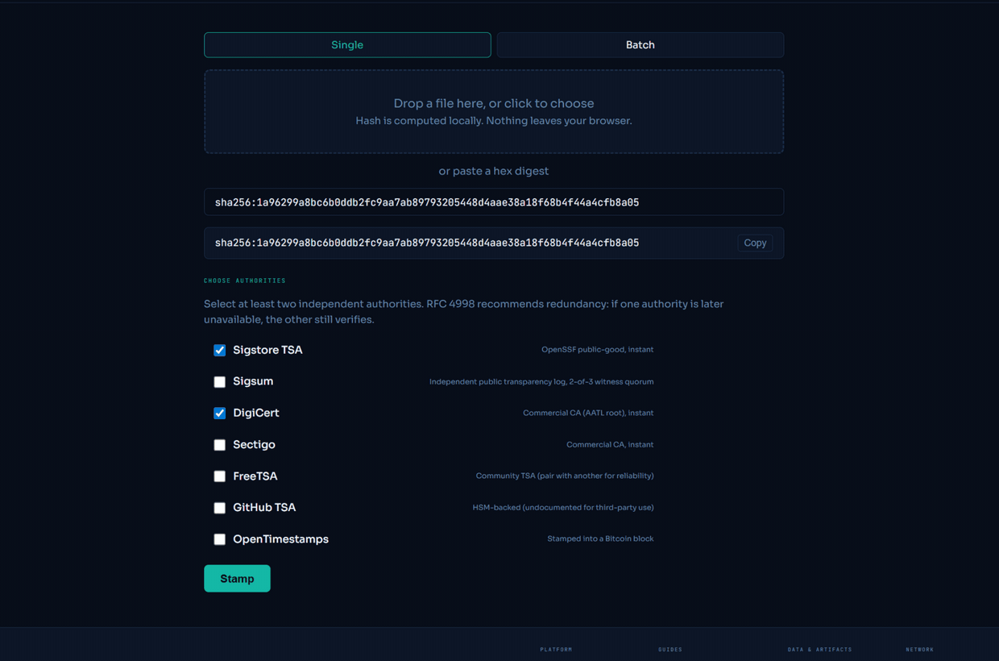

# Anchor Suite

Timestamp a hash with independent authorities and verify the receipt forever. Live at [anchor.ainumbers.co](https://anchor.ainumbers.co).

This repo is for engineers, compliance teams, and the agents that work for them: anyone who needs durable, independently verifiable proof that a document or data artifact existed at a point in time.



## How it works

1. Your file is hashed in your browser with SHA-256. The file never leaves your machine.
2. The hash is sent to one or more timestamp authorities (RFC 3161 TSAs, or the OpenTimestamps Bitcoin calendars). Each returns a signed timestamp token.
3. The tokens verify offline, against certificate roots pinned in this repo, for as long as the math holds. You do not need this site to verify them.

Post Oak Labs never sees your document, never stores your hash, and is not the timestamp authority. The authorities are named in your receipt.

## Solana memo anchors (verification only)

A receipt may carry a `solana-memo` anchor binding (OpenChainGraph §20.4). This suite never creates one: there is no Solana key, secret or funding anywhere in this repo, and writing anchors is out of scope by design. The suite only VERIFIES a binding you received: it names a cluster, a transaction signature, a slot, a commitment level and a signer key, and proves the anchored hash was committed in that transaction's memo. Because reading a Solana transaction requires an RPC, this is the one binding type with no offline verification. You choose the endpoint (a field on the verify page, a `solana_rpc` argument on the MCP tool); verification reads `getTransaction` at finalized commitment and checks the memo data, the slot and the signer, plus an optional signer allowlist you supply from the receipt publisher's published key list. A Solana memo proves the hash was committed no later than the recorded slot by the holder of the recorded signer key. It is a ledger-ordering anchor like a Bitcoin OpenTimestamps commitment: no RFC 3161 token, no eIDAS status, no signed time, and blockTime is a validator estimate.

## Layout

| Path | Purpose |
|---|---|
| `public/` | Static pages served at anchor.ainumbers.co. Plain HTML plus ES modules. No build step, no CDNs, no analytics. |
| `public/vendor/` | Vendored, committed libraries: PKI.js bundle, javascript-opentimestamps, OpenChainGraph offline verifiers. |
| `public/vendor/roots/` | Pinned TSA root certificates. Sources and hashes in [ROOTS.md](ROOTS.md). |
| `src/worker.mjs` | The tsa-relay Worker: a stateless, body-verbatim pipe to the classic CA timestamp authorities that do not send CORS headers. The only server-side code in the suite. |
| `scripts/` | CI gates and the TSA smoke harness. |

## The relay

Classic CA timestamp authorities (DigiCert, Sectigo, FreeTSA) do not answer browser requests directly. The relay accepts a DER TimeStampReq at `/relay/{digicert|sectigo|freetsa}`, pipes it verbatim to the hardcoded upstream, and pipes the DER TimeStampResp back verbatim. It parses nothing, stores nothing, and logs no request bodies. It is rate limited to 4 requests per minute per IP and times out after 25 seconds.

## Principles

- No secrets in this repo, ever. There is nothing to leak.
- No storage server-side. The relay is a pipe.
- No third-party scripts, no CDNs, no analytics. Every library is vendored and committed.
- Verification is client-side. RFC 3161 and Sigsum verification runs offline after first load. OpenTimestamps proofs are different: verifying one contacts the calendars named in the proof, looking for a Bitcoin upgrade of a pending proof, and a block explorer for the Bitcoin header check; a solana-memo binding reads the Solana RPC endpoint you choose. In every case your file and its hash never leave the browser.
- Deploys go through the gated GitHub Actions workflow only. Cloudflare Workers Builds stays disconnected so there is exactly one deployer.

## Development

```
npm install
npx wrangler deploy --dry-run   # bundle check, deploys nothing
node scripts/run-gates.mjs      # all CI gates locally
node scripts/smoke-tsa.mjs      # stamp a fixed test hash at every authority and verify
```

Branch, open a pull request, squash-merge. CI runs the gates on every pull request and deploys from `main` after they pass.

## License

MIT. Vendored libraries keep their own licenses, noted in [VENDORED.md](VENDORED.md).
